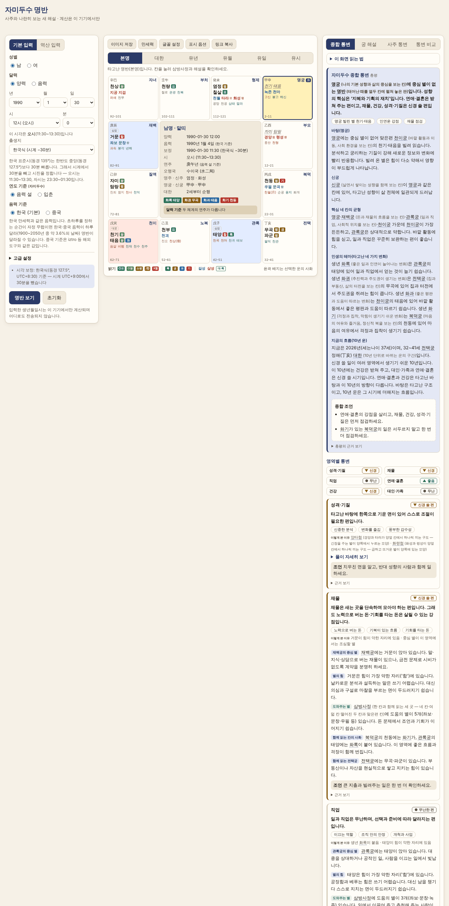
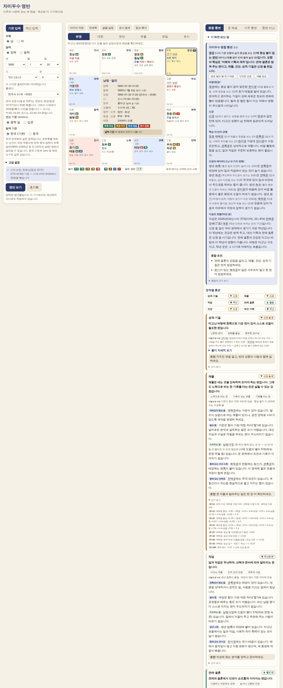
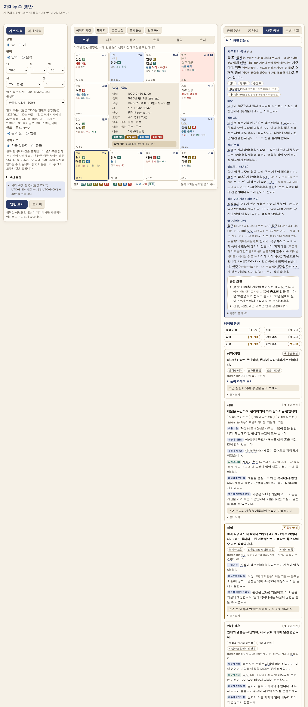
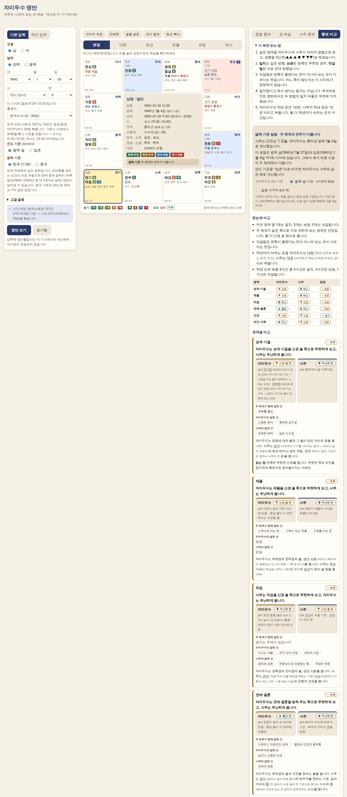
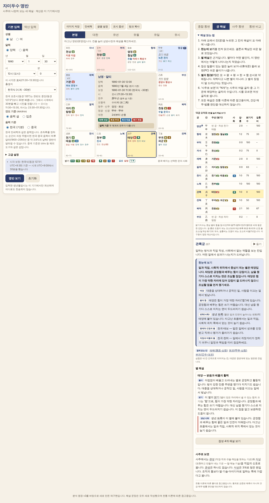
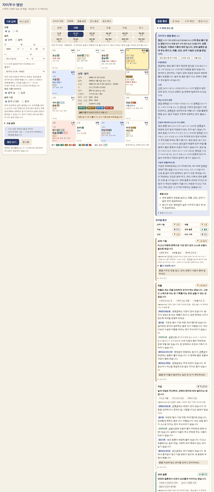
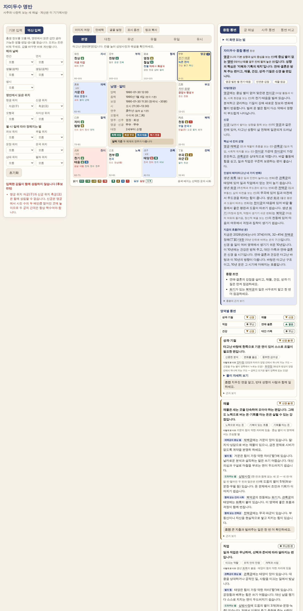
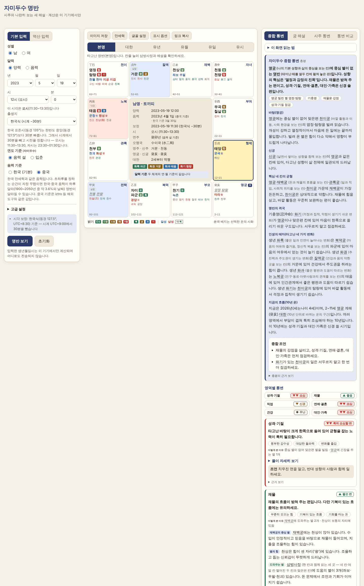

# 자미두수 명반 + 종합 통변 + 사주 통변·비교

자미두수 명반에 **종합 통변**(총평 + 영역별 + 10년 흐름)을 붙이고, 같은 사람의 **사주 통변**과 **두 통변을 영역별·시기별로 견주는 비교**까지 보여 주는 웹사이트입니다. 「플러스자미두수 리버스 분석 원장 v3」(`docs/00-analysis-ledger-v3.*`)을 바탕으로 **다시 만들었습니다** — 기존 사이트가 맞는 곳은 재현하고, 원장이 찾은 오류(I-01~I-14)는 고치고, 빠진 기능(사주 비교)을 채웠습니다. 해설 문장·화면·로고는 모두 새로 작성했고 원본의 글·이미지·CSS 는 복사하지 않았습니다.

**계산은 모두 브라우저 안에서 이루어지고, 입력한 생년월일시는 어디로도 전송되지 않습니다.** (E2E 로 외부·비-GET 요청이 0 임을 확인합니다.)



> **이 문서의 상태** — 단계: 분석 → 설계 → 개발 → 검증 → 피드백 완료(쉬운 해설 개선 · 한국식 시각 · 통변까지 한 바퀴씩 더 돌았습니다). 결과는 `docs/` 에 있습니다(아래 “문서”). **사용자가 정한 것**: 음력 기본 기준 = 한국, 달력 입력 기본 = 양력, 해설은 분량 무관·이해하기 쉽게, 시진은 시계에서 30분을 빼 :30 에 끊기, 종합 통변·사주 통변·통변 비교. 남은 결정은 [피드백](docs/05-feedback.md) 에 있습니다.
>
> **통변을 쓰기 전에 알아 두세요** — 통변은 전통 이론의 일부를 **규칙(84개)으로 옮긴 간이판**이고 점수표의 수치는 설계자가 정한 값이며 **전문가 감수를 받지 않았습니다.** 두 체계의 판정이 일치하는 비율을 재 보니 서로 무관한 점수의 기대값과 같아서(일치 33.3% · 보완 42.3% · 엇갈림 24.4%), **“두 방법이 같은 말을 하니 믿을 만하다”고 할 수 없습니다.** 건강·재물·관계에 관한 문장은 생활 점검의 참고이며 진단·투자·법률 조언이 아닙니다.

## 빠른 시작

Node.js **22.12 이상의 22.x** 가 필요합니다(`.nvmrc` = 22, `package.json` 의 `engines` = `22.x`). 다른 메이저(24 등)는 시험하지 않았습니다.

```bash
npm ci            # 설치 + 의존성 패치 자동 적용(postinstall). --ignore-scripts 를 쓰지 마세요
npm run dev       # 개발 서버
npm run build     # 정적 빌드 → dist/
npm run preview   # 빌드 결과 미리보기
```

`dist/index.html` 은 서버 없이 **파일을 더블클릭해서 열어도** 동작하고, 하위 경로(`/Zamidusu/` 등)에 올려도 동작합니다(한 개의 스크립트로 묶어 `file://` 의 모듈 제한을 피합니다).

### 배포 (정적 파일이라 새 저장소는 필요 없습니다)

계산이 모두 브라우저 안에서 이루어지므로 서버가 없어도 됩니다. 이 저장소를 그대로 연결하면 됩니다.

| 방법 | 설정 |
|---|---|
| **Vercel** | vercel.com → Add New → Project → 이 저장소 Import. Framework **Vite**(자동 감지), Build `npm run build`, Output `dist`, **Node.js 22.x**, 환경변수 없음. 설치 명령에 `--ignore-scripts` 를 쓰지 마세요(설치 때 의존성 패치가 적용됩니다). Production Branch 는 저장소의 기본 브랜치를 따릅니다 |
| GitHub Pages | Settings → Pages → Source 를 “GitHub Actions” 로 바꾼 뒤 Actions 탭에서 `Deploy to GitHub Pages` 를 수동 실행(`.github/workflows/pages.yml`) |
| 파일 | `npm run build` 후 `dist/index.html` 을 더블클릭 |

공유 링크는 입력값을 주소의 `#` 해시에 담아 서버 접근 기록에 남지 않으므로, 호스팅 서비스의 방문 분석(Analytics) 기능은 켜지 않는 것을 권합니다. 저장소가 public 이면 `docs/` 의 역분석 원장 등 문서도 함께 공개됩니다.

| 명령 | 하는 일 |
|---|---|
| `npm run typecheck` | `tsc --noEmit` (strict) |
| `npm test` | 단위·시나리오 테스트 300건 (약 3분) |
| `npm run build && npm run e2e` | 실제 Chromium 으로 브라우저 E2E 302건 (약 1분 30초). `CHROME_PATH` 로 브라우저 지정 가능 |
| `npm run test:inventory` | `docs/generated/test-inventory.md` 다시 만들기 |
| `npm run e2e:report` | `docs/generated/e2e-results.md` 다시 만들기 |
| `CALIBRATE=1 npx vitest run tests/calibrate-tongbyeon.test.ts --testTimeout=1800000` | 통변 경향 단계의 경계값(`src/core/tongbyeon/calibration.ts`)을 무작위 출생 표본으로 다시 만들기(약 3분 10초, 같은 시드라 결과는 늘 같음) |
| `WRITE_TONGBYEON_DOCS=1 npx vitest run tests/tongbyeon-rules.test.ts tests/tongbyeon-text.test.ts` | 통변 규칙표·샘플 문서 다시 만들기 |
| `npm run gen:lunar-kr` | 한국 음력 표(`src/core/lunarkr-data.ts`) 다시 만들기 |
| `npm run gen:notices` | `THIRD_PARTY_NOTICES.md` 다시 만들기 |

## 기능

- **명반**: 4×4 격자의 12궁에 14주성·길성·살성·잡성·12신·사화·대한 구간·밝기를 표시. 칸을 누르면 **삼방사정**(+4·+8 삼합, +6 대궁)이 강조됩니다. 빈 궁은 대궁 주성을 빌려 읽는 차성안궁을 안내합니다.
- **운 모드 6종**: 본명 · 대한 · 유년 · 유월 · 유일 · 유시. 운을 바꾸면 궁 이름·운 사화·해설이 그에 맞게 바뀝니다.
- **입력**: 양력/음력(윤달), 시·분, 성별, 출생지(국내 162곳 + 해외 25곳 + 경도 직접 입력)에 따른 **진태양시 보정**(경도 + 균시차, 시간대 이력·서머타임·1954~61년 UTC+8:30 반영). 범위는 1900~2100년. 오류는 모아서 한 번에 안내합니다.
- **한국식 시각(기본)**: 한국 표준시(동경 135°)는 한반도 중앙(동경 127.5°)보다 30분 빠르므로 **시계에서 30분을 빼서 시진을 :30 에 끊습니다**(오시 = 11:30~13:30, 자시 = 23:30~01:30). 입력 아래에 “이 시각은 오시(11:30~13:30)입니다” 미리보기가 나옵니다. 시계 시각 그대로 보려면 출생지에서 “시계 시각 그대로”를 고르세요(원본 사이트와 같은 값). 이 때문에 **같은 시계 시각의 :00~:29 는 이전 시진**으로 나옵니다.
- **연도 기준**: 음력 설(기본) / 입춘. 입춘은 날짜가 아니라 **출생 순간**으로 판정합니다.
- **음력 기준**: 한국(기본, 한국천문연구원 방식) / 중국(중국 표준시, iztro 계열 도구와 같음). 같은 생일시가 기준에 따라 **다른 명반**이 되는 날이 1900~2050년 중 3.59% 입니다(예: 2023-05-19 12시). 화면에 알림을 띄웁니다.
- **역산 입력**: 출생 정보를 모를 때, 명반에서 읽은 값(명궁·신궁 위치, 오행국, 자미성·좌보·우필·문창·문곡·삼태·팔좌 위치)과 아는 해·날짜 정보만 골라 가능한 생월·생일·생시 후보를 찾고, 후보와 연도를 골라 바로 명반을 만듭니다. 값이 서로 모순되면 어떤 값들이 충돌하는지 설명합니다.
- **시 모름**: 12시진 명반 비교표를 보여 줍니다.
- **종합 통변(자미두수)**: 명반 전체를 하나로 엮은 **총평**(명궁의 별 · 핵심 네 칸의 균형 · 명반 격국 · 생년 사화가 만드는 테마 · 지금의 10년 흐름 · 종합 조언)과 **영역 6개**(성격·기질 · 재물 · 직업 · 연애·결혼 · 건강 · 대인·가족)별 결론·핵심 주제·“이렇게 본 이유”·근거, 그리고 **대한 10구간**(100세까지)의 흐름을 보여 줍니다. 경향은 ▲▲ ▲ ● ▼ ▼▼ 5단계(색뿐 아니라 기호와 글자)이며, 점수가 **무작위 출생 전체에서 어느 위치인지**를 뜻하는 상대 단계이고 예언이 아닙니다.
- **사주 통변**: 일간·강약(신강/신약)·격국·용신 한 줄 요약, 십성 구조(식상생재 · 관인상생 등)와 글자끼리의 합·충, 영역 6개, 대운 흐름(만 나이)을 같은 모양으로 보여 줍니다. 용신은 전문가마다 달리 잡는다는 점을 화면에 적었습니다.
- **통변 비교**: 같은 6개 영역과 10년 단위 시기(대한 ↔ 연도가 가장 많이 겹치는 대운)에서 두 통변이 **일치 / 보완(한쪽만 뚜렷) / 엇갈림**인지 판정하고, 각자 무엇을 보고 그렇게 말했는지와 함께 말한 주제·따로 말한 주제를 보여 줍니다. **어느 쪽이 맞는지는 판정하지 않습니다.** 옛 이론 비교 10항목(달력·오행·대운 구조)과 사주 4기둥 병기표는 접어서 두었습니다.
- **통변의 근거**: 모든 결론에 규칙 번호(예: ZP-04, S-WE3)와 이 명반의 값이 붙고 접어서 볼 수 있습니다. 규칙표는 [docs/generated/tongbyeon-rules.md](docs/generated/tongbyeon-rules.md)(84개), 경계값과 단계 비율은 [tongbyeon-calibration.md](docs/generated/tongbyeon-calibration.md) 에 있습니다.
- **해설(쉬운 말)**: 칸마다 맨 앞에 **한눈에 보기**(결론 한 단락 + 핵심 항목)가 나오고, 그 뒤에 별 해설(근거)과 사주로 보면이 이어집니다. 별 66개 × 궁 12 × 밝기·사화·운 모드에 반응하는 새 문안입니다. 전문용어는 일상어로 풀어 쓰거나 **처음 나올 때 풀이를 붙이고**(점선 밑줄은 눌러서/올려서 풀이), 사주 쪽 숫자에는 “많은 편·적은 편” 같은 **뜻**을 붙입니다. 별 카드 속 사주 대응과 사주 비교의 근거는 **접혀** 있고, “해설 읽는 법”이 맨 위에 있습니다. 분량은 제한하지 않되 한 문장은 60자 이하로 씁니다.
- **부가**: 이미지(PNG) 저장 · 만세력 · 글꼴 설정(크기·서체) · 표시 옵션(밝기 5/7단계, 별 이름 한글·한자 등) · 링크 복사 · 해설 듣기 · 다크 모드 · 모바일 5탭 배치(명반 · 종합 통변 · 궁 해설 · 사주 통변 · 통변 비교).

| 화면 | |
|---|---|
| 종합 통변(총평 + 영역별 + 이렇게 본 이유) |  |
| 사주 통변(일간·강약·격국·용신, 대운 흐름) |  |
| 통변 비교(일치 · 보완 · 엇갈림) |  |
| 쉬운 해설(한눈에 보기·읽는 법·사주로 보면) |  |
| 운 모드(대한) |  |
| 역산 입력(모순 설명) |  |
| 음력 기준 차이 알림 |  |

그 밖의 화면: [시 모름](docs/screenshots/04-hour-unknown.png) · [이미지 저장 결과](docs/screenshots/06-exported-image.png) · [모바일 명반](docs/screenshots/07-mobile-chart.png) · [모바일 종합 통변](docs/screenshots/16-mobile-tongbyeon.png) · [모바일 해설](docs/screenshots/08-mobile-explain.png) · [다크 모드](docs/screenshots/10-dark-mode.png) · [태블릿 폭](docs/screenshots/11-tablet-1024.png)

## 사용 팁

- **링크 공유**: “링크 복사”는 입력값을 주소의 해시(`#y=1990&m=1&d=30…`)에 담습니다. 해시는 브라우저가 서버로 보내지 않으므로 생년월일시가 서버 접근 기록에 남지 않습니다. 예전의 `?y=…` 형식 링크는 읽기만 합니다.
- **시계 시각 그대로 보기**: 출생지에서 “시계 시각 그대로”를 고르거나 링크에 `p=standard` 를 붙입니다(원본 사이트와 같은 시진 경계). 기본은 한국식(−30분)입니다.
- **음력 기준을 중국으로**: 입력부의 “음력 기준”에서 고르거나 링크에 `lb=cn` 을 붙입니다.
- **원본 호환 모드**(`?compat=1`): 원본 사이트의 알려진 오류(I-01~I-08)를 일부러 재현하는 **검증 전용** 스위치입니다. 화면에 경고 띠가 뜨고, 링크로만 켜집니다. 평소에는 쓰지 마세요.
- **연도 기준이 헷갈릴 때**: 입춘 직전·직후에 태어났다면 “연도 기준”을 바꿔 보고 통변 비교 탭의 달력 기준 알림을 확인하세요.

## 구조

```
src/core/      계산(DOM 의존 없음): time(시각 정규화·한국식 보정) chart(포국·운 모드) saju(4기둥) compare(이론 비교)
               reverse(역산) lunarkr(한국 음력) independent(검증용 독립 구현) explain/(해설 문안) …
src/core/tongbyeon/  통변 엔진(13파일): 규칙표 → 점수 → 경계값 → 단계 → 주제·이유·근거 → 문장, 비교·시기 짝짓기
src/ui/        React 화면과 상태(App, InputPanel, ChartBoard, ExplainPanel, TongbyeonPanel, SajuTongbyeonPanel, ComparePanel …)
tests/         vitest 300건 / e2e/  Playwright-core 302건
scripts/       의존성 패치 적용, 한국 음력 표 생성, 고지문·목록 생성
patches/       lunar-lite 수정본과 manifest(해시) — patches/README.md
docs/          원장 · 설계 · 검증 보고서 · 품질확인서 · 피드백 · 자동 생성 증거(통변 규칙표·경계값·샘플·독자 시험 포함) · 스크린샷
```

명반 엔진은 `iztro`, 사주는 `lunar-javascript` 입니다. UI 는 계산하지 않고 `src/core` 의 결과만 그립니다.

### 의존성 패치 (알아 두세요)

두 가지 때문에 `lunar-lite@0.2.8` 의 파일 5개를 설치 직후 덮어씁니다 — ① 입춘 기준 연주가 **날짜 단위**라 입춘 당일 절입 전 출생을 새해로 계산, ② 음력이 **중국 표준시(UTC+8)** 날짜로 계산되어 한국 음력과 다른 날(I-15). 덮어쓰기는 파일 해시가 원본과 정확히 같을 때만 하고, 하나라도 다르면 **아무것도 쓰지 않고 설치를 멈춥니다**. 자세한 내용은 [patches/README.md](patches/README.md).

## 검증과 품질

“코드가 돈다”가 아니라 **요구사항이 맞는지**를 봤습니다. 엔진 결과를 엔진 자신과 비교하지 않고 전통 구결에서 다시 쓴 독립 구현, 한국천문연구원 자료 기반 외부 라이브러리, 천문 공식과 대조했습니다.

| 수단 | 규모 | 결과 |
|---|---|---|
| 단위·시나리오 | 300건(3건은 문서·경계값 생성기라 건너뜀) | 통과 |
| 브라우저 E2E | 302건 / 23흐름 | 통과, 콘솔 오류 0, 외부 요청 0 |
| 포국 대 독립 구현 | 약 1,900건 | 불일치 0 |
| 한국 음력 대 한국천문연구원 자료 기반 | 55,121일 | 불일치 0 |
| 한국식 시각 대 독립 공식 | 하루 1,440분 전수 + 무작위 8,000건 + 시간대 이력 3,000건 | 불일치 0 |
| **통변 점수 대 독립 구현** | 사주 20,000개 · 영역 점수 72,000개 / 자미두수 명반 800개 × 6영역 | 불일치 0(자미두수 최대 차이 0.0077, 허용 0.02) |
| **통변 규칙 일관성·도달성** | 명반 300개 · 규칙 84개 | 위반 0 · 규칙 84/84 발동 |
| **통변 문장 규칙** | 명반 300개 · 문장 169,046개 | 위반 0(최대 55자) |
| **통변 변이 검사**(시험이 잡는지 일부러 망가뜨려 확인) | 56종 | 56종 모두 감지 |
| 접근성(axe-core) | 47개 화면 상태 | 위반 0 |
| 쉬운 해설 규칙 | 모든 별 카드 조합 + 칸 해설 8,640칸 | 60자 넘는 문장 1,765 → 0, 표시 없는 전문용어 17,843 → 0, 모든 칸에 한눈에 보기 |
| 독자 시험 — 쉬운 해설(**AI 독자** 3명 × 5칸, 개선 전·후) | 15쌍 | 질문 점수 57/90 → 90/90, 쉬운 정도 2.2 → 3.5(5점 만점) |
| **독자 시험 — 통변**(**AI 독자** 3명 × 3차례, 고치고 다시) | 9명 | 사실 문항 35/39 → 39/39 → 39/39, 엮은 풀이로 읽힘 3.0 → 3.67, 쉬움 2.33 → 3.0(5점 만점) |
| `npm audit` | 개발 의존성 포함 | 취약점 0 |

검증 중 설계에 없던 결함 23건을 찾아 고쳤습니다(1차 10건 + 쉬운 해설 개선 중 문안 결함 6건 + 통변 7건, [검증 보고서](docs/03-verification-report.md) §5). 판정: **적합(조건부 포함)** — 요구사항 67개 중 적합 57 · 조건부 적합 9 · 사용자 결정으로 대체 1(I-13 해설 길이 균일 → 쉬운 말). 원장이 승인 대기로 둔 N-05 는 이번에 **규칙 기반 간이 통변으로 구현**했고 조건부 적합입니다. 이 판정은 개발자의 **자기 검증**이며 독립 검토가 아닙니다.

**한계**: 원본 사이트를 직접 볼 수 없어 **사이트와의 일치는 확인하지 못했습니다**(대조 방법은 [피드백](docs/05-feedback.md) §2). 해설은 전통 이론에 따른 참고용이고 통계로 검증된 예측이 아니며, 명리 전문가의 감수를 받지 않았습니다. **통변은 규칙 기반 간이판이고 점수표의 수치는 설계자가 정한 값입니다. 두 체계의 판정 일치율은 우연 수준이라 일치를 신뢰의 근거로 읽을 수 없습니다.** 경향 단계는 점수의 상대 위치이고 대한 단계는 지지의 음양에 따라 번갈아 오르내리는 명반이 있습니다. **“쉽게 읽힌다”는 자동 검사와 AI 독자 시험까지만 확인했고 사람 독자 시험은 하지 않았습니다**(통변은 삼방사정·별 이름·구도 이름이 풀이를 붙여도 어렵다는 지적이 남아 있습니다). 해설 분량은 늘었습니다(칸당 평균 954자 → 1,289자). 한국식 시각의 기본 결과는 원본 사이트와 달라질 수 있습니다. 한국 음력 2051~2100년은 같은 규칙의 계산값입니다. Firefox·Safari·실기기·스크린 리더는 확인하지 않았습니다.

## 문서

| 문서 | 내용 |
|---|---|
| [00 분석 원장 v3](docs/00-analysis-ledger-v3.md) | 입력(원본 그대로) — 사이트 역분석 결과, F·R·I·U·N·D 요구 |
| [01 설계서](docs/01-design.md) | 요구사항 추적표, 구조, 도메인 규칙, 화면, 검증 계획 + **부록 A 구현 중 변경 사항** + **부록 B 쉬운 해설 개선** + **부록 C 한국식 시각** + **부록 D 종합 통변·사주 통변·통변 비교**(모델·규칙·구현 결과와 설계에서 달라진 점) |
| [03 검증 보고서](docs/03-verification-report.md) | 검증 수단·결과(V-01~V-32)·발견한 결함 23건·변이 검사·독자 시험 |
| [04 품질확인서](docs/04-quality-certificate.md) | 요구사항별 판정과 조건 |
| [05 피드백](docs/05-feedback.md) | 정해 주세요 · 사이트와 대조 방법 · 다음 단계 · 위험 · 원장 v4 제안 |
| `docs/generated/` | 자동 생성 증거: 테스트 목록(300건), E2E 결과(302건), 시나리오 결과표 |
| [해설 샘플(개선 후)](docs/generated/explain-sample.md) · [해설(개선 전)](docs/generated/explain-before-6a91282.md) | 시나리오 T6 의 12궁 해설 전문을 같은 방식으로 옮긴 것 — 전·후 비교용 |
| [독자 시험(쉬운 해설)](docs/generated/reader-test/README.md) | 개선 전·후 같은 질문으로 읽힌 시험(입력·답 원문·채점표) |
| [통변 규칙표](docs/generated/tongbyeon-rules.md) · [경계값과 단계 비율](docs/generated/tongbyeon-calibration.md) · [통변 샘플(세 사람)](docs/generated/tongbyeon-sample.md) | 화면의 “근거 보기”에 나오는 규칙 번호의 뜻 · 점수를 단계로 나누는 경계와 실제 비율 · 세 탭의 전문을 글로 옮긴 것 |
| [독자 시험(통변)](docs/generated/tongbyeon-reader-test/README.md) | AI 독자 3명 × 3차례의 입력·답 원문·기계 채점(`score.mjs`)과 차례마다 고친 것 |

## 라이선스와 고지

- 이 저장소의 **라이선스는 아직 정하지 않았습니다**(저장소 소유자가 정할 일입니다). 정하기 전에는 모든 권리가 보유된 것으로 취급됩니다.
- 배포물에 포함되는 오픈소스 11개는 모두 MIT 이며 고지문과 라이선스 전문은 [THIRD_PARTY_NOTICES.md](THIRD_PARTY_NOTICES.md) 에 있습니다. `lunar-lite` 수정본의 원 저작권 고지는 `patches/lunar-lite/LICENSE` 입니다.
- 개발 전용 의존성 `korean-lunar-calendar`(한국 음력 대조용 검증 기준)는 배포물에 들어가지 않습니다.
- 모든 예시 입력은 임의 값이며 실존 인물이 아닙니다.
